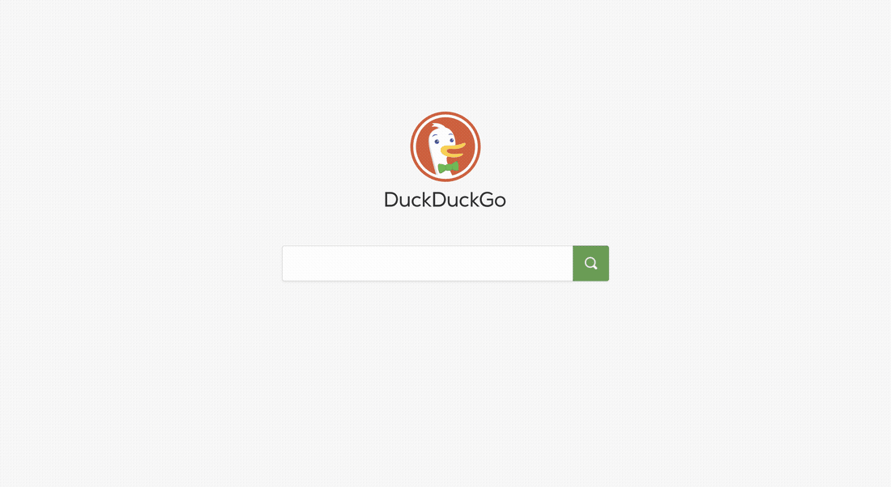

# DSH Chrome Bridge

Drive **your own Chrome** from [DeepSeek Harness](https://github.com/deepseek-ai/deepseek-harness) — the same architecture Claude's Chrome integration uses: a browser extension performs every action inside the window you are already looking at.



*Search, submit, open a result — driven by the agent, executed in the visible browser.*

```text
agent tool (chrome_*)
      │
      ▼
DSH plugin: localhost HTTP bridge (127.0.0.1, token-authenticated)
      ▲                    │ long poll
      │                    ▼
      └──────── Chrome extension (MV3 service worker)
                     │ chrome.tabs / chrome.scripting / captureVisibleTab
                     │ (+ chrome.debugger for trusted input)
                     ▼
              your Chrome window — you watch it happen
```

Nothing runs headless. Every click, keystroke and navigation happens in the browser you are looking at, so you can see what the agent is doing and stop it.

## Why an extension instead of `--remote-debugging-port`

| | Debug port (CDP) | Extension (this project) |
|---|---|---|
| Starting Chrome | must relaunch with a flag | normal launch |
| Extra banner | "Chrome is being controlled" | none (unless you opt into CDP mode) |
| Fresh Chrome profile | usually a separate profile | your real profile, your logins |
| Setup | one flag | load an unpacked extension once |

## Requirements

- Chrome 116 or newer (tested on 156)
- Node.js 20+ (only for running the plugin's tests / packaging)
- A DeepSeek Harness profile you can install a local bundle into

## Install

### 1. Install the plugin into DSH

Install the bundle with the harness plugin manager (`plugin_manager` → `install_bundle`), pointing at either:

- npm: `dsh-plugin-chrome-bridge`
- a checkout: `/absolute/path/to/dsh-chrome-bridge`

The bundle inserts one row (`chrome-bridge`) and starts a localhost bridge on port `47311`. The port and the access token are written to:

```
~/.dsh/storages/chrome-bridge/config.json
```

### 2. Load the extension in Chrome

1. Open `chrome://extensions`
2. Turn on **Developer mode**
3. **Load unpacked** → select the `extension/` directory of this repo

### 3. Pair them

1. Open the extension's options (card → Details → Extension options)
2. Fill in the port (`47311`) and the token from `config.json`
3. **Save** → **Test connection**

A green `ON` badge on the extension icon means the bridge is live. `SET` means the token is missing, `OFF` means it cannot reach the bridge.

## Tools

| Tool | What it does |
|---|---|
| `chrome_status` | connection state, port, tab count |
| `chrome_list_tabs` | list tabs (id / title / url / active) |
| `chrome_query` | list interactive elements with usable CSS selectors + labels |
| `chrome_open` | open a new tab |
| `chrome_activate` | bring a tab to the front |
| `chrome_navigate` | navigate a tab |
| `chrome_read_text` | read the page's visible text |
| `chrome_click` | click by CSS selector **or visible text**; optional wait for selector/URL |
| `chrome_type` | fill a field, optionally submit; optional wait |
| `chrome_press` | send a key (Enter / Escape / Tab / arrows) |
| `chrome_wait` | wait for load, a selector, or a URL fragment |
| `chrome_net` | list the backend calls the page made |
| `chrome_screenshot` | capture the visible area to PNG |
| `chrome_eval` | run JS in the page (fails on strict-CSP sites) |
| `chrome_close` | close a tab |
| `chrome_cdp` | inspect or toggle CDP mode |

## CDP mode (opt-in)

By default the bridge uses `chrome.scripting`, which means synthetic events: fast, no banner, but with real limits — `Enter` does not trigger a form's default submit, drag & drop and canvas interactions do nothing, and `chrome_net` cannot see HTTP methods or request bodies.

Turn on **CDP mode** in the extension options to attach `chrome.debugger` and send real input:

- clicks become `Input.dispatchMouseEvent` (trusted, real coordinates)
- `Enter` becomes `Input.dispatchKeyEvent` (triggers default actions, submits forms)
- typing becomes `Input.insertText`
- `chrome_net` gains `method`, `status`, and a request-body preview

While attached, Chrome shows its "being debugged" infobar. Turning CDP mode off detaches immediately and the banner disappears.

## Configuration

`cordis.patch.yml`:

| Key | Default | Meaning |
|---|---|---|
| `port` | `47311` | bridge port; falls back to an ephemeral port if taken |
| `allowedHosts` | `[]` | non-empty = only these hosts (and subdomains) may be opened or navigated |
| `captureDir` | `""` | where screenshots go; empty = `~/.dsh/storages/chrome-bridge/captures` |
| `autoStart` | `true` | start the bridge with the plugin |

## Security

- The bridge listens on `127.0.0.1` only and rejects requests without the token.
- The token is generated on first run and stored in `~/.dsh/storages/chrome-bridge/config.json` (mode `0600` is your responsibility to keep).
- **`allowedHosts` is empty by default, which means the agent can drive any http(s) site, including your logged-in admin tools and banking.** Set it for real use.
- The extension requests `<all_urls>` (it must, to script arbitrary pages) and `debugger` (only used when CDP mode is on).

See [SECURITY.md](SECURITY.md) for reporting and the full threat model.

## Known limitations

- **Synthetic mode**: `element.click()` and `input` events; some sites reject untrusted input. Use CDP mode for those.
- **`chrome_eval`** is blocked on strict-CSP sites; prefer `chrome_query` / `chrome_read_text`.
- **Screenshots** capture the visible viewport only, and activate the tab first.
- **Service worker lifetime**: Chrome suspends idle MV3 workers; the extension keeps a 30-second alarm watchdog and reconnects automatically. Tools report "extension not connected" while it is down.
- **Unpacked extension code changes** require a manual reload (↻) in `chrome://extensions`.

## Development

```bash
npm run check            # syntax check every entry point
npm test                 # unit tests (node:test, no dependencies)
npm run pack:extension   # write dist/dsh-chrome-bridge-extension-<version>.zip
npm run verify           # check + test
```

CI runs the same commands on Node 20 and 22.

## License

MIT — see [LICENSE](LICENSE).
